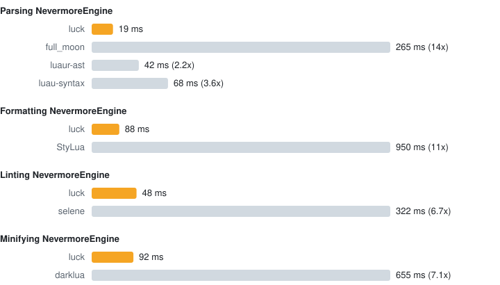

<div align="center">

<a href="https://github.com/esoware/luck">
  
</a>

[![MIT licensed][license-badge]][license-url] [![Luau][luau-badge]][luau-url] [![Rust][rust-badge]][rust-url] [![CodSpeed][codspeed-badge]][codspeed-url]

</div>

Luck is an extremely fast Luau toolchain. It formats, lints, type checks, bundles, and minifies Luau, for standalone scripts and for Roblox, with one CLI and one config file.

## Install

```sh
cargo install luck_cli
```

Building it needs clang, for Luau's type checker. Install [LLVM](https://github.com/llvm/llvm-project/releases), or on macOS, Xcode's command line tools.

## Usage

```sh
luck init          # create a luck.json
luck build         # bundle the project into a single file
luck fmt src/      # format
luck lint src/     # lint, and fix with --fix
luck check src/    # report syntax, compile, and type errors
luck lsp           # run the language server
```

Every command reads its settings from the nearest `luck.json`.

## Benchmarks

<picture>
  <source media="(prefers-color-scheme: dark)" srcset="assets/benchmark-dark.svg">
  
</picture>

The chart is from [luck-benchmarks](https://github.com/esoware/luck-benchmarks), which also runs each tool on two more real Luau codebases.

## Tools

- A Prettier-style formatter that handles Luau's full type syntax
- A linter with 63 rules, auto-fixes, and suppression comments
- Luau's own type checker, built from Luau's C++ source
- A language server with diagnostics, hover, completion, go-to-definition,
  references, and rename, used by the [VS Code extension](editors/vscode)
- A bundler that turns a multi-file project into one file with no runtime
  library
- A minifier that strips types, folds constants, removes dead code, and renames
  locals

Luck knows Luau's standard library out of the box. Add `"@roblox"` to
`definitions` in `luck.json` for Roblox's API, or a
[definition file](crates/luck_stdlib/README.md#definition-files) for any other
host, such as Lune.

## Build on top of Luck

Every tool is also a Rust crate:

- Parse Luau: [`luck_parser`](crates/luck_parser)
- Format Luau: [`luck_formatter`](crates/luck_formatter)
- Lint Luau: [`luck_linter`](crates/luck_linter)
- Minify Luau: [`luck_minifier`](crates/luck_minifier)
- Bundle Luau projects: [`luck_bundler`](crates/luck_bundler)
- Resolve requires: [`luck_resolver`](crates/luck_resolver)
- Type check Luau: [`luck_type_checker`](crates/luck_type_checker)
- All of the above in one crate: [`luck_luau`](crates/luck)

## Contribute

Issues and pull requests are welcome. See [CONTRIBUTING.md](CONTRIBUTING.md)
for setup and pull requests.

## License

Luck is free and open-source software licensed under the
[MIT License](LICENSE).

[license-badge]: https://img.shields.io/badge/license-MIT-blue.svg
[license-url]: LICENSE
[luau-badge]: https://img.shields.io/badge/Luau-standalone%20%7C%20Roblox-00A2FF
[luau-url]: https://luau.org
[rust-badge]: https://img.shields.io/badge/Rust-1.99%2B-orange?logo=rust
[rust-url]: https://www.rust-lang.org
[codspeed-badge]: https://img.shields.io/endpoint?url=https://codspeed.io/badge.json
[codspeed-url]: https://app.codspeed.io/esoware/luck?utm_source=badge
